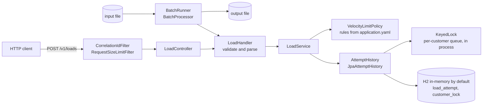
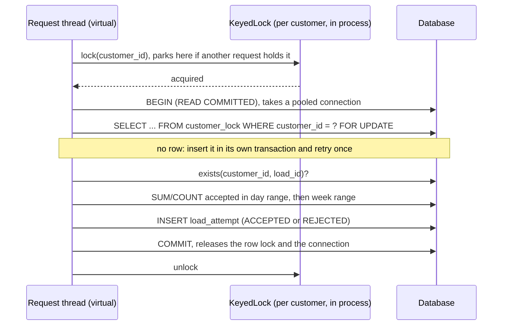

# Velocity limits service: engineering design <!-- omit in toc -->

Author: Emmanuel Akinpelu. Status: implemented as a take-home, not deployed. Last updated 2026-11-05.

## Table of Contents <!-- omit in toc -->
<!-- TOC -->

- [1. Context](#1-context)
- [2. Goals and non-goals](#2-goals-and-non-goals)
- [3. Assumptions and decisions](#3-assumptions-and-decisions)
- [4. Design overview](#4-design-overview)
  - [4.1 Database schema](#41-database-schema)
- [5. Built beyond the task](#5-built-beyond-the-task)
- [6. How a load is decided](#6-how-a-load-is-decided)
  - [6.1 REST](#61-rest)
  - [6.2 Batch](#62-batch)
- [7. Concurrency, retries and idempotency](#7-concurrency-retries-and-idempotency)
  - [7.1 The problem](#71-the-problem)
  - [7.2 The mechanism](#72-the-mechanism)
  - [7.3 Duplicates, retries and idempotency](#73-duplicates-retries-and-idempotency)
  - [7.4 Several instances](#74-several-instances)
  - [7.5 What is and is not guaranteed](#75-what-is-and-is-not-guaranteed)
- [8. Alternatives considered](#8-alternatives-considered)
- [9. Testing](#9-testing)
  - [9.1 Automated suite](#91-automated-suite)
  - [9.2 Concurrency and retry check against a running instance](#92-concurrency-and-retry-check-against-a-running-instance)
- [10. Path to production](#10-path-to-production)
  - [10.1 Database](#101-database)
  - [10.2 Instances, routing, and why not a distributed lock](#102-instances-routing-and-why-not-a-distributed-lock)
  - [10.3 Edge: load balancer and API gateway](#103-edge-load-balancer-and-api-gateway)
  - [10.4 Observability stack](#104-observability-stack)
  - [10.5 CI/CD](#105-cicd)
  - [10.6 Deploy strategies](#106-deploy-strategies)
  - [10.7 Kubernetes and Terraform](#107-kubernetes-and-terraform)
- [11. Monitoring and alerts](#11-monitoring-and-alerts)
- [12. Risks](#12-risks)
- [13. Open questions](#13-open-questions)


<!-- /TOC -->


## 1. Context

Venn's task: build a Spring Boot service that accepts or declines attempts to load funds into a customer's account, in real time. Each attempt is one line of JSON:

```json
{"id":"1234","customer_id":"1234","load_amount":"$123.45","time":"2018-01-01T00:00:00Z"}
```

Each attempt gets one answer, `{"id":"1234","customer_id":"1234","accepted":true}`. Each customer may load at most $5,000 per day, $20,000 per week and 3 loads per day. A day ends at midnight UTC, and a week starts on Monday. If a load ID repeats for a customer, every instance after the first is ignored and gets no response. The program must process Venn's `input.txt` and produce their `output.txt`. It should use a relational database, preferably in-memory, handle errors and logging well, and have tests.

The service does this two ways over one decision path: a REST endpoint (`POST /v1/loads`) and a batch mode that reads a file of JSON lines and writes a file of decisions.

## 2. Goals and non-goals

**Goals**

- Produce Venn's expected output exactly from Venn's input. It does: the diff is empty (section 9.1).
- Make a limit impossible to exceed, even when many requests for one customer arrive at once, on one instance or on several sharing a database.
- Make retries safe: a repeated `(customer_id, id)` is decided once and never counted twice.
- Keep limits as configuration, and store every decision with the rule that rejected it.
- Keep the behaviour easy to troubleshoot: correlation IDs in logs, Prometheus metrics, structured errors.

**Non-goals**

- Authentication and authorization. They belong at the gateway (section 10.3), and the app has none today.
- Currency conversion. `$` is read as CAD.
- A production deployment. Section 10 covers what changes.
- Replaying the original decision for a repeated load. The task says to give no response, so the API returns 204 (open question 1).
- Enforcing chronological input. The task promises it, and the service does not check it (section 7.5).

## 3. Assumptions and decisions

| Assumption | Where it comes from | Evidence |
|---|---|---|
| A repeated load ID is ignored even when the first attempt was declined. | Task: "all but the first instance can be ignored". | Venn's only repeat (customer 562, load 6928) follows a decline, and Venn's output has no line for it. |
| Limits are inclusive: a total of exactly $5,000 is allowed. | Reading of "a maximum of $5,000". | Not covered by Venn's data: no attempt lands exactly on a cap, and inclusive and exclusive caps give identical output. The committed edge-case fixture and unit tests pin the inclusive behaviour. |
| `$` means CAD. | The task doesn't say. | Assumed. It only matters once a second currency exists. |
| Input arrives in chronological order. | Task. | Assumed, not checked. |
| Day is the UTC date, and the week starts Monday 00:00 UTC. | Task. | Unit-tested, including Sunday 23:59:59 to Monday rollover and a `-05:00` offset that crosses UTC midnight. |

**Decided: declined loads do not count toward any limit, amount or count.** A declined load moved no money, so it should not consume the customer's allowance. Venn's data confirms this for amounts: counting declined amounts would change 42 of the 999 decisions. For the 3-per-day count, the data cannot tell the two readings apart, because both produce identical output.

## 4. Design overview



The controller and the batch runner are thin adapters over `LoadHandler`, which validates and parses the input and calls `LoadService`, so both modes validate and decide identically. Packages are grouped by feature, and dependencies point one way: `batch -> loads -> attempts -> velocity -> money`.

| Package | Holds |
|---|---|
| `loads` | `LoadController`, `LoadHandler`, `LoadService`, request/response records, `LoadExceptionHandler` (`ProblemDetail`), `StrictJson` (Jackson settings) |
| `loads.attempts` | The `AttemptHistory` interface plus `LoadAttempt`, `Decision` and `DuplicateLoadException`. The JPA entities, the repositories, `JpaAttemptHistory` and `KeyedLock` are package-private. |
| `loads.batch` | `BatchRunner` (an `ApplicationRunner` active only with `--input`/`--output`) and `BatchProcessor` |
| `velocity` | The rule engine: `VelocityRule`, `Limit` (`MaxLoads`/`MaxAmount`), `WindowType` (`DAY`/`WEEK`), `TimeRange`, `VelocityLimitPolicy`, and the Spring config binding. No database or loads dependency. |
| `money` | `Money`: `long` minor units plus a `Currency`. No floating point anywhere. |
| `observability` | `CorrelationIdFilter` |
| `web` | `RequestSizeLimitFilter` (8 KiB body cap) |

### 4.1 Database schema

Flyway applies two migrations from `src/main/resources/db/migration`. Hibernate runs with `ddl-auto: validate`, so startup fails if the entities and the migrated schema disagree.

`V1__create_load_attempt.sql`:

```sql
CREATE TABLE load_attempt (
    id               BIGINT GENERATED BY DEFAULT AS IDENTITY PRIMARY KEY,
    load_id          VARCHAR(64)               NOT NULL,
    customer_id      VARCHAR(64)               NOT NULL,
    amount_minor     BIGINT                    NOT NULL,
    currency         VARCHAR(3)                NOT NULL,
    occurred_at      TIMESTAMP WITH TIME ZONE  NOT NULL,
    status           VARCHAR(16)               NOT NULL,
    rejection_reason VARCHAR(64),
    created_at       TIMESTAMP WITH TIME ZONE  DEFAULT CURRENT_TIMESTAMP NOT NULL,
    CONSTRAINT ck_load_attempt_amount CHECK (amount_minor > 0),
    CONSTRAINT uq_load_attempt_customer_load UNIQUE (customer_id, load_id),
    -- Avoids CHECK ... IN (...): H2 2.4 fails to evaluate it once the creating Flyway connection closes.
    CONSTRAINT ck_load_attempt_reason CHECK (
        (status = 'ACCEPTED' AND rejection_reason IS NULL)
        OR (status = 'REJECTED' AND rejection_reason IS NOT NULL))
);

CREATE INDEX ix_load_attempt_customer_status_time ON load_attempt (customer_id, status, occurred_at);
```

`V2__create_customer_lock.sql`:

```sql
CREATE TABLE customer_lock (
    customer_id VARCHAR(64) PRIMARY KEY
);
```

`uq_load_attempt_customer_load` is the per-customer idempotency key, and its index serves the duplicate check. `ck_load_attempt_reason` makes a reason present exactly when the status is `REJECTED`. Column widths match validation: IDs and rule names (stored as the reason) are at most 64 characters, and `currency` is an ISO 4217 code. `occurred_at` is the client's `time`; `created_at` is set by the database. `ix_load_attempt_customer_status_time` matches the totals query, with equality on customer and status and a range on `occurred_at`, so a sum reads only that customer's accepted rows in the window. `customer_lock` has one row per customer, there only to be locked (section 7). Invalid and duplicate attempts are not stored.

## 5. Built beyond the task

The task alone needs a single-threaded loop over one table: three hard-coded checks and the seen IDs. For each addition: what it is, why, and what still does not extend.

- **Rules as configuration.** Limits are entries under `velocity.rules` (name, window `DAY` or `WEEK`, metric `AMOUNT` or `COUNT`, `max` or `max-in-cents`, optional currency), checked in order. The first broken rule's name is stored as the reason, and an invalid rule set fails startup. *Why:* limits change for business reasons, and every decline can be explained. *Limits:* only UTC calendar days and weeks, so a rolling window or a month needs code in `WindowType`. Only two metrics. Rules are per-instance config, so changing them means a deploy (10.6).
- **Exact money with a currency.** Integer minor units plus a currency column, with amount rules optionally scoped to one currency (`AdditionalCurrencyTest` covers USD and JPY). *Why:* floating point cannot hold cents exactly, and a per-currency limit becomes configuration. *Limits:* input accepts only `$`, read as CAD, so a second currency needs a new input format and a `LoadHandler` change. `COUNT` rules take no currency. An amount rule without a currency applies to each currency separately, with its cap in that currency's minor units: the default 500_000 is $5,000 CAD, but also 500,000 minor units of any other currency. Currencies are never added together.
- **Per-customer serialization.** An in-process `KeyedLock` queue, plus `SELECT ... FOR UPDATE` on a `customer_lock` row in a READ COMMITTED transaction (section 7). *Why:* a batch is sequential, but a real-time API is not (7.1). *Limits:* protecting several instances needs a shared database.
- **Duplicates and idempotency.** An existence check under the lock, backed by the `(customer_id, load_id)` unique constraint. Declined IDs stay seen, and the API answers a repeat with 204. *Why:* retries stay safe under concurrency and across instances. *Limits:* no replay of the original decision, and a changed payload is silently ignored (open questions 1 and 4).
- **Strict input.** Strict JSON, allow-listed IDs sized to the columns, exact amount and time formats, and an 8 KiB body cap (section 6). *Why:* bad input should fail at the edge, never in the database or the logs.
- **API surface.** The endpoint lives under `/v1/`, so a breaking change can ship as `/v2` beside it. Errors are RFC 9457 `ProblemDetail` bodies (400, 413, 500). springdoc serves an interactive UI at `/docs` and the spec at `/api-docs`, and actuator exposes health with liveness and readiness groups. *Why:* callers get a stable contract and docs they can try, and an orchestrator gets probes. *Limits:* the docs and actuator share the public port (10.3).
- **Correlation IDs and metrics.** `X-Correlation-Id` (or `batch-<uuid>`) on every log line, and `loads.processed` by outcome and reason at `/actuator/prometheus`. *Why:* one request can be followed through the logs, and the decision mix can be watched. *Limits:* lock-wait and queue-depth metrics are missing (section 11).
- **A versioned schema.** Flyway SQL in standard types, with the invariants as constraints (section 4.1) and `ddl-auto: validate`. *Limits:* it has only run on H2, MySQL would need different identity and timestamp types (10.1), and the default is in-memory H2 (risk 1).

## 6. How a load is decided

### 6.1 REST

1. `CorrelationIdFilter` takes `X-Correlation-Id` if it matches `[A-Za-z0-9._-]{1,64}`, or generates a UUID. It puts the ID in the MDC and echoes it in the response header.
2. `RequestSizeLimitFilter` refuses bodies over 8 KiB with 413. That covers both a declared `Content-Length` and a chunked stream that grows past the cap.
3. Jackson rejects a repeated key, and a number or boolean where a string is expected (`"id": 15`).
4. `LoadHandler` trims the fields and validates them:
   - `id` and `customer_id` are required, at most 64 characters, from `[A-Za-z0-9._-]`.
   - `load_amount` must match `$` plus 1 to 15 digits plus an optional 1 or 2 decimals, and must be positive. `$1,000.00` and `12.50` are rejected.
   - `time` is ISO-8601 with an offset, years 1970 to 9999, truncated to microseconds so a stored time stays in the window it was checked against.

   Any failure is a 400 `ProblemDetail` naming the field, and nothing is stored.
5. `LoadService.process` runs the decision under the customer lock (section 7):
   1. If `(customer_id, id)` already exists, it reports a duplicate.
   2. Otherwise it evaluates the rules against the accepted totals and saves the attempt with its outcome.
6. After the commit, the service logs the outcome and increments `loads.processed`. It returns 200 with `{id, customer_id, accepted}`, or 204 with no body for a duplicate.

An unexpected exception becomes a 500 `ProblemDetail` with no internal detail. Logs for unreadable bodies name the error type and position but never echo the body.

### 6.2 Batch

Run it as `java -jar target/venn-take-home-0.0.1-SNAPSHOT.jar --input=<file> --output=<file>`. When either option is present, `main` starts Spring without a web server. `BatchRunner` reads the input one line at a time, calls the same `LoadHandler`, and writes one JSON line per decision, in input order, with LF line endings.

- A repeated load writes no line.
- A blank line is skipped, and a leading byte-order mark is stripped.
- A malformed line (bad JSON, a non-object, or a field that fails validation) is logged with its line number and skipped. Bytes that are not valid UTF-8 are replaced, so at worst that one line fails instead of the whole file.
- An infrastructure failure, such as a database error, aborts the run. The log says "the output file is incomplete", and the process exits non-zero.
- The runner refuses to write over its own input.

Each run's log lines share one `batch-<uuid>` correlation ID, and the run ends with a summary, such as `BatchSummary[linesRead=1000, responsesWritten=999, duplicatesIgnored=1, invalidLines=0]` on Venn's input. With the default in-memory database, each run starts empty.

## 7. Concurrency, retries and idempotency

### 7.1 The problem

A decision is a read followed by a write: sum the accepted loads, compare with the cap, insert. Two concurrent requests for one customer can both read the same totals and both be accepted. The commit that added the row lock (`7eb5bab`) records that, without it, 500 simultaneous $100 loads for one customer accepted 81 against a limit of 3.

### 7.2 The mechanism



`JpaAttemptHistory.withCustomerLock` serializes the decisions for one customer in two layers.

1. **The in-process queue (`KeyedLock`).**
   - It keeps one fair `ReentrantLock` per customer ID, and drops the entry once no request holds or waits for it.
   - A request waits here *before* its transaction opens, so it takes a pooled connection only after the queue lets it through. A queued request costs a parked virtual thread, not a connection.
   - The method refuses to run inside an existing transaction (`IllegalStateException`). Otherwise the caller's transaction would keep its connection while parked in the queue. The lock work would also join that transaction, so the row lock would outlive the queue slot and the READ COMMITTED pin would be skipped.
   - Virtual threads are on (`spring.threads.virtual.enabled`), so parked requests do not use up Tomcat's worker threads either.
2. **The row lock.**
   - It is a `PESSIMISTIC_WRITE` lock (`SELECT ... FOR UPDATE` on H2) on the customer's `customer_lock` row. The lock, the totals and the insert all run in one transaction.
   - That transaction is pinned to READ COMMITTED, so the totals see the previous lock holder's commit. A snapshot taken before the wait would not.
   - A new customer's lock row is created in a separate transaction. A unique violation there means another request or instance created the row first, and is ignored; the request then locks the row and continues.

The two layers do different jobs.
- **The row lock is the correctness guarantee.** It is the only thing shared between instances, and it sits in the same transaction as the decision's reads and write.
- **The in-process queue protects the connection pool.** Without it, 50 queued requests for one hot customer would each hold a pooled connection on the row lock, and with Hikari's default pool of 10, everyone else would stall. With it, at most one connection per customer per instance waits on the row lock.

I checked this split by removing each layer in turn, in a scratch copy of the repo:

- **Row lock removed, queue kept:** both `MultiInstanceTest` cases fail, accepting too many loads in round 0 or 1. The queue alone protects nothing across instances.
- **Queue removed, row lock kept:** every limit test still passes. Only `customersQueuedBehindAHotCustomerDoNotUseUpTheConnectionPool` fails: with 20 requests behind a hot customer, another customer can't get a connection within a second.

Each transaction waits on only one lock, the customer's row, so lock-ordering deadlocks cannot happen. The H2 URL sets `LOCK_TIMEOUT=5000` (risk 7).

### 7.3 Duplicates, retries and idempotency

The existence check runs under the lock, so a concurrent repeat waits, then sees the first attempt's committed row. The unique constraint backstops anything that writes outside the lock: a violation becomes `DuplicateLoadException`, which is also treated as a duplicate. A declined ID stays seen, so a retry of a declined load returns 204 and is not re-evaluated, even if the customer now has headroom.

What a client sees when it retries:

| What happened to the first attempt | What the retry gets |
|---|---|
| 400 (invalid input) | 400 again if resent unchanged. Nothing was stored, so a corrected request is evaluated fresh. |
| 500, lock timeout or lost connection | Usually nothing was stored, and the retry is evaluated fresh. If the commit landed before the failure, for example when the connection dropped during `COMMIT`, the retry gets 204. |
| Committed, but the response was lost | 204. The load counted once, but the retry does not say whether it was accepted. |
| Sent several times at once | One 200, and 204 for every other copy (40 copies decided once in `LoadConcurrencyTest`; one 200 and 199 204s over HTTP in `load-check.py`) |
| Same ID, different amount or time | 204. The new payload is silently ignored. |

So each key is decided and stored at most once, and a retry never re-decides it. The service does not replay responses; open questions 1 and 4 ask whether it should.

### 7.4 Several instances

Correctness across instances needs a shared database with row-level locks. `MultiInstanceTest` runs five Spring contexts against one H2 TCP server. Over 25 rounds it sends exactly one load per instance at the same instant, through a barrier, so each instance's in-process queue is idle and only the row lock keeps the decisions apart. Every round accepts exactly 3 of 5 for the count limit, and exactly 1 of 5 at $5,000 for the amount limit.

The default configuration is **not** multi-instance safe. The in-memory H2 database is private to each process, so two instances started as-is each enforce the limits on their own data, letting a customer load the daily limit once per instance. Several instances need `SPRING_DATASOURCE_URL` pointed at a shared database. With N instances on a shared database, one hot customer can park at most N connections fleet-wide: one per instance, each waiting on the row lock.

### 7.5 What is and is not guaranteed

**Guaranteed** with a shared database that honours row locks and READ COMMITTED, and covered by tests:

- No customer's accepted loads in any rule window exceed that rule's cap, whatever the concurrency or instance count.
- A `(customer_id, id)` is decided at most once.
- Requests for different customers do not wait on each other, apart from sharing the connection pool and the database.

**Not guaranteed:**

- **Order.** Concurrent requests for one customer are decided in lock order, not timestamp order: arrival order within one instance, and whatever the database grants across instances.
- **Out-of-order input.** The caps still hold, since each check sums every accepted row in the load's window, but a load can be declined because of a later-timestamped one.
- **Bounded waiting.** The in-process queue has no length cap and no timeout (risk 3).
- **Trustworthy timestamps.** The client supplies `time`, and the service trusts it (open question 3).

## 8. Alternatives considered

**Lock the customer's `load_attempt` rows instead of a lock row.** Fails for a customer's first load in a window: there are no rows to lock yet, so two first loads both pass. A dedicated row per customer always exists after the first attempt.

**Optimistic concurrency** (a version column, retry on conflict). Under a burst for one customer, most attempts conflict and redo their work, unfairly. A fair queue plus a pessimistic lock decides each once, in arrival order.

**SERIALIZABLE isolation.** Needs a retry loop, gives many aborts under a hot customer, and behaves differently on H2, Postgres and MySQL. An explicit row lock behaves the same on all three.

**Database advisory locks** (Postgres `pg_advisory_xact_lock`, MySQL `GET_LOCK`). These would remove the `customer_lock` table, but they are vendor-specific: MySQL's lock is session-scoped, so it outlives the transaction, and H2 has no equivalent.

**Running-total tables** instead of `SUM` over attempts. A new window would need a new table and a backfill, and the totals could drift from the log. With the default rules, the indexed `SUM` reads at most 21 rows a week.

**A distributed lock (Redis, ZooKeeper).** Rejected; see section 10.2.

## 9. Testing

### 9.1 Automated suite

`./mvnw test` runs 239 tests. The last run, on 2026-11-05 with JDK 27.0.1 (the project targets Java 25), had 0 failures and 0 skipped. `question/` was present, so the full Venn comparison ran.

| Layer | Classes | What they establish |
|---|---|---|
| Rules and windows | `VelocityRuleTest`, `VelocityLimitPolicyTest`, `LimitTest`, `WindowTypeTest`, `MoneyTest` | Totals exactly at a cap are accepted and one cent over is rejected, and the 4th load of a day is rejected. The first broken rule is reported. Windows are half-open, and the Sunday-to-Monday rollover works, including across a year. Money is exact. |
| Decision logic | `LoadServiceTest` (in-memory `AttemptHistory`) | The task's examples. Declined loads don't count. Daily and weekly resets. Repeats are ignored, including a repeat of a declined load and a concurrent one. |
| Validation | `LoadHandlerTest` (60 cases), `LoadControllerTest`, `RequestSizeLimitFilterTest`, `CorrelationIdFilterTest` | Field rules, amount and time formats, the 8 KiB cap, and correlation-ID sanitising. |
| Configuration | `VelocityConfigTest`, `DefaultRulesTest`, `CustomRulesEndToEndTest`, `AdditionalCurrencyTest` | Bad rule sets fail startup. A different rule set changes decisions with no code change. Per-currency amount rules work, including JPY. |
| Repository | `JpaAttemptHistoryTest` (`@DataJpaTest` on H2 with the real migrations) | Range bounds. Only accepted rows are summed. Per-currency sums, while the count covers every currency. A duplicate becomes `DuplicateLoadException`. The lock refuses to run inside a transaction. |
| API | `LoadApiTest`, `ActuatorEndpointsTest`, `OpenApiDocsTest`, `H2ConsoleProfileTest`, `DatabaseCredentialsTest` | The full MVC stack: 200, 204, 400, 413 (including chunked bodies), repeated keys, non-string IDs, sub-microsecond timestamps at a window edge, and `loads.processed` in the Prometheus scrape. |
| Concurrency | `KeyedLockTest`, `LoadConcurrencyTest` | 40 simultaneous loads for one customer accept exactly 3, or exactly 1 at $5,000. 40 copies of one load are decided once. With one customer's lock held and 20 requests queued behind it, another customer still completes within 1 s. |
| Multi-instance | `MultiInstanceTest` | Five contexts on one H2 TCP server, 25 rounds per limit (section 7.4). It fails if the row lock is removed (section 7.2). |
| Batch end to end | `BatchEndToEndTest`, `BatchRunnerTest`, `BatchProcessorTest` | The committed fixture (exactly $5,000, Sunday-to-Monday, a `-05:00` offset, a blank line, `{not json`, a missing `$`, a repeat after a decline) must match a hand-written expected file. With `question/` present, Venn's input must match Venn's output, ignoring CRs. |

I also ran the packaged jar in batch mode on Venn's input. It read 1,000 lines and wrote 999 responses, with 1 duplicate ignored and 0 invalid. `diff <(tr -d '\r' < "question/Venn - Back-End - Output .txt") output.txt` printed nothing.

### 9.2 Concurrency and retry check against a running instance

`scripts/load-check.py [base-url]` (default `http://localhost:8080`) fires real HTTP traffic at a running instance. Each run uses fresh IDs, so it can be rerun against the same instance, and every load is timestamped 2018-01-01T00:00:00Z, so all of them share one day and week. The bursts print req/s and p50/p99/max latency. The hot-customer burst prints only the other customers' latency, and the sequential retry check prints neither. The script exits non-zero if any check fails.

| Traffic | Client workers | What it proves |
|---|---|---|
| 500 loads of $100 for one customer | 100 | The count limit holds under contention: exactly 3 accepted, and all 500 return 200 (no 5xx). |
| 200 loads of $5,000 for one customer | 100 | The amount limit holds: exactly 1 accepted. |
| 1,000 customers, one load each | 100 | Different customers don't interfere, and 1,000 lock rows are created during the burst without error. |
| The same load sent 200 times at once | 100 | Concurrent duplicates are decided once: one 200 and 199 204s. |
| 3,000 loads over 300 customers, 10 each, interleaved | 300 | Each of the 300 customers gets exactly 3 accepted. The script checks each customer separately. |
| 1,000 loads for one hot customer, then 500 other customers submitted 50 ms later | 200 | The hot customer still gets exactly 3, and all 500 others are accepted. The others' latency shows whether they wait behind the hot customer's queue. |
| A declined $5,000.01 load, then 50 sequential retries of it | 1 | A declined ID stays seen: every retry gets 204. A fresh evaluation would return 200 again. |

I ran it twice against a freshly started `java -jar target/venn-take-home-0.0.1-SNAPSHOT.jar` on port 8080, on a local Mac with the default in-memory H2. All seven checks passed both times. Each run sends 6,451 requests. The first run took 3.7 s and the second 2.2 s; the opening burst went from 449 to 2,041 req/s. During the hot-customer burst, the other customers' p99 was 43 ms in the first run and 77 ms in the second. A sample line from the first run:

```
PASS  1000 loads for one customer while 500 other customers load: hot accepted=3 (want 3), cold accepted=500 (want 500), cold p50=24ms p99=43ms max=57ms
```

Limits of this check:

- It exercises one instance; `MultiInstanceTest` alone covers several.
- With 200 client workers taking tasks in order, the hot queue never exceeds about 200, and the other customers overlap only its tail. The pool-starvation guarantee comes from `LoadConcurrencyTest`.
- Timings include the Python client's overhead and are laptop numbers, not capacity numbers.

All seven checks also passed against the Docker image in OrbStack over HTTPS; its timings (130–240 req/s, p99 up to 2.5 s) include OrbStack's proxy, so they are not comparable.

## 10. Path to production

### 10.1 Database

Use a production-grade relational database, for example Postgres or MySQL. Run it as a managed service with a synchronous standby and point-in-time recovery. Nothing in the design needs a particular vendor. The one hard requirement: a shared server database with row-level locking and READ COMMITTED, or an equivalent where each statement sees the latest commits.

- **Schema.** The migrations have only ever run on H2. Before trusting them on the chosen database, add a Testcontainers run of `JpaAttemptHistoryTest`, `LoadConcurrencyTest` and `MultiInstanceTest` against it, plus a case-variant check (customers `A` and `a`).
  - On Postgres, the V1 DDL should work as written.
  - On MySQL, `TIMESTAMP WITH TIME ZONE` becomes `DATETIME(6)`, with `DEFAULT CURRENT_TIMESTAMP(6)` on `created_at`, and the identity column becomes `AUTO_INCREMENT`. Flyway's `{vendor}` locations can hold the variant. The `ck_load_attempt_*` checks are only enforced from MySQL 8.0.16.
    - MySQL's default collation is case-insensitive, so declare `load_id` and `customer_id`, in both tables, as `COLLATE ascii_bin`. Otherwise customers `abc` and `ABC` would share one lock row and one set of totals.
    - `CURRENT_TIMESTAMP(6)` records the session's local time, so pin the session to UTC (server `time_zone='+00:00'`, or Connector/J `connectionTimeZone=UTC&forceConnectionTimeZoneToSession=true`).
    - `DATETIME` ends at 9999-12-31, so a load in 9999's last days gets a window end that MySQL cannot store.
- **Row lock and isolation.** `PESSIMISTIC_WRITE` becomes `FOR UPDATE` on MySQL and `FOR NO KEY UPDATE` on Postgres (Hibernate 7). Both conflict with themselves, so the row still serializes decisions. The code pins READ COMMITTED, which matters wherever a database or role defaults to REPEATABLE READ.
  - On Postgres, a REPEATABLE READ snapshot is taken at the first statement, before the lock wait, so the totals would miss the previous holder's commit. Even under READ COMMITTED, the pin costs one `SHOW TRANSACTION ISOLATION LEVEL` round trip per decision, because pgjdbc does not cache the level.
  - On MySQL/InnoDB, which defaults to REPEATABLE READ, the snapshot is taken at the first non-locking read. Here that comes after the wait, so it is safe either way. But the in-code pin costs round trips per decision: a `SET`, a reset, and a level check. Setting `transaction_isolation = READ-COMMITTED` on the server, or `spring.datasource.hikari.transaction-isolation=TRANSACTION_READ_COMMITTED`, makes it a no-op, and `useLocalSessionState=true` skips the check's query.
- **Lock timeout.** `LOCK_TIMEOUT=5000` is an H2 URL setting and does not carry over. The code sets no JPA lock-timeout hint (`CustomerLockRepository` has only `@Lock`); if one is added, check the SQL Hibernate emits. On Postgres, set `lock_timeout` at role level (`ALTER ROLE ... SET lock_timeout = '5s'`), which survives any pooler, or use `options=-c%20lock_timeout=5s` on the JDBC URL for direct connections. On MySQL, set `innodb_lock_wait_timeout` (default 50 s). Add a statement timeout too: `statement_timeout` on Postgres, `max_execution_time` on MySQL (SELECTs only).
- **Connections.** The total is instances × pool size (Hikari defaults to 10), and it must stay under the database's connection limit.
  - *Overload.* Virtual threads remove Tomcat's 200-worker cap, so under overload every request queues on Hikari, waits its 30 s default `connectionTimeout`, then fails with a 500. Set `spring.datasource.hikari.connection-timeout` to 2000–5000 (milliseconds), and cap concurrency at the gateway or with `server.tomcat.max-connections` (alert: pool starvation, section 11).
  - *Proxy poolers* (PgBouncer, ProxySQL) can raise the ceiling, and the transaction-scoped row lock works behind them.
  - *PgBouncer in transaction mode* breaks pgjdbc's server-side prepared statements (unless `prepareThreshold=0`, or PgBouncer 1.21+ with `max_prepared_statements`) and session-level `SET`s. It also breaks the READ COMMITTED pin if the role's default isolation differs. Spring calls `setTransactionIsolation` only on a mismatch, so stock Postgres is fine, but pgjdbc sends that call as a session-level `SET SESSION CHARACTERISTICS`, which leaks to other clients. `ALTER ROLE app SET default_transaction_isolation = 'read committed'` keeps the pin a no-op.
- **Growth and retention.** The totals query reads only the load's own day and week, as chosen by its `time`. Duplicate detection is a point lookup on the `(customer_id, load_id)` unique index, but it is only correct while every past `(customer_id, load_id)` is retained.
  - Partitioning `load_attempt` would force the unique key to include the partition column, on both Postgres and MySQL, so a repeat with a different time would slip through. Archiving old partitions would also make old IDs look new.
  - So first move dedupe into its own unpartitioned table, keyed by `(customer_id, load_id)`, and keep it for the retention period (open question 5).
  - Only then partition `load_attempt`, preferably by `created_at`. The server sets `created_at`, so a client-supplied time cannot place a row in an archived partition.
  - Do not count on `created_at` to prune the totals query. That would need `time` to stay close to the server clock, and batch replays of historical files break that (risk 4).
- **Credentials.** Inject them from a secret manager through `SPRING_DATASOURCE_*`. The `user`/`password` in `application.yaml` are local defaults only.

### 10.2 Instances, routing, and why not a distributed lock

Run stateless instances, all active, against one primary database. The row lock is the correctness guarantee, and per-instance queueing is an optimization. The worst case is one parked connection per hot customer per instance. There are two levers for reducing cross-instance contention:

1. **Sticky routing by customer ID.** A consistent hash at the load balancer sends a customer's traffic to one instance, so contention resolves in that instance's queue. The row lock is then normally uncontended, but still covers rebalancing and failover. The catch: `customer_id` is in the JSON body, and load balancers hash on headers or paths, so this needs an API change (an `X-Customer-Id` header or `/v1/customers/{id}/loads`). A hot customer also pins one instance. Do it only if the lock-wait metric (section 11) shows contention consuming pools.
2. **A distributed lock (Redis or ZooKeeper).** Not recommended. It cannot replace the row lock: without fencing tokens, a lease can expire during a GC pause or network stall, and two holders then both commit. It would add a third mechanism and a dependency on every request, only to remove the up-to-N parked connections per hot customer, which sticky routing removes more cheaply.

### 10.3 Edge: load balancer and API gateway

- **TLS.** Terminate at the load balancer or ingress; re-encrypt or use mTLS inside if policy requires.
- **Authentication.** Do it at the gateway, with OAuth2 client credentials (JWT) or mTLS, since the caller is presumably an internal payments service. The app can also validate the JWT itself (Spring Security resource server).
- **Rate limiting.** Limit per client at the gateway. A per-customer limit would also bound the in-process queue (risk 3), but it needs the customer ID outside the body, as in 10.2.
- **Routing.** Route only `/v1/*` publicly. Today `/actuator/*` and `/docs`/`/api-docs` share port 8080 with the API. Move actuator to `management.server.port`. Turn the docs off in production with `springdoc.api-docs.enabled=false` and `springdoc.swagger-ui.enabled=false`; `/docs` redirects to `/swagger-ui/index.html`, so a path rule would also need `/swagger-ui/**`.

### 10.4 Observability stack

- **Logs.** Emit JSON (`logging.structured.format.console`) and ship it to ELK, Loki or Datadog; the correlation ID is already in the MDC. Customer IDs appear in INFO logs for rejections and duplicates, so the logs need a PII review.
- **Metrics.** Prometheus scrapes `/actuator/prometheus` for Grafana, or Datadog reads the same endpoint.

### 10.5 CI/CD

- **Every pull request.** Run `./mvnw verify`, which includes the multi-instance test, plus the Testcontainers run against the production database engine from 10.1.
- **The Venn comparison** skips itself in CI because `question/` is gitignored. Supply the files as a protected artifact, or rely on the committed edge-case fixture.
- **The image.** Build from the `Dockerfile`, scan (e.g. Trivy), and push tagged with the git SHA. It builds, runs and passes the load check locally (9.2), but is not yet built in CI or scanned.
- **Staging.** Deploy, run `scripts/load-check.py` as a smoke test, then promote. It writes test rows, so never in production.
- **Migrations.** Keep them backward compatible (expand, then contract), because old and new versions run side by side during a rollout. Run Flyway as a separate job before the rollout, and set `spring.flyway.enabled=false` on the app pods. `ddl-auto: validate` still fails a pod's startup if the job has not run.

### 10.6 Deploy strategies

- **Rolling.** The default, safe for code changes. A `velocity.rules` change is the exception: mid-rollout, old and new instances enforce different limits.
- **Blue/green.** For a rule change needing one cutover point, with instant rollback. The shared schema must suit both colours.
- **Canary.** For decision-path changes: compare the canary's `loads_processed_total` by outcome and reason, and 5xx ratio, with the baseline.
- **Active/active versus active/passive.**
  - Within a region, all instances serve traffic against one primary database.
  - Across regions, the per-customer guarantee needs a single writer, so run active/passive: a replicated standby database and app tier, with failover. With asynchronous replication, failover can lose the last few accepted loads and their dedupe keys. Some customers could then briefly exceed a limit, and a retry of a lost load would be decided again.
  - Multi-region active/active would need customers homed to a region, or a globally serializable database (Spanner, CockroachDB). Not warranted at this scale.

### 10.7 Kubernetes and Terraform

- **Ownership.** Terraform owns the infrastructure (network, managed database, cluster, secrets, IAM, DNS, certificates). Helm or Kustomize via Argo CD owns the app: 3+ replicas, a PodDisruptionBudget, and an HPA.
- **Scaling.** Each replica brings its own connection pool, so set the HPA's `maxReplicas` from the connection budget in 10.1.
- **Probes.** Keep them on the main port, since a probe on the management port can pass while the main connector is broken. Set `management.endpoint.health.probes.add-additional-paths=true`, and probe `/livez` and `/readyz` on 8080.
- **Shutdown.** Graceful shutdown is already Spring Boot's default, with a 30 s `spring.lifecycle.timeout-per-shutdown-phase`. Set `terminationGracePeriodSeconds` above that, and add a short `preStop` sleep so the load balancer stops routing to the pod first. A request queued behind a hot customer has no upper bound on its wait until the queue gets a timeout (risk 3), so some requests can still be cut off.

## 11. Monitoring and alerts

What a running instance exposes at `/actuator/prometheus` today:

- **`loads_processed_total{outcome="accepted"|"rejected"|"duplicate"}`,** with `reason="<rule name>"` on rejections. It is counted after commit. Invalid requests are not counted here; they show up as `status="400"` in the HTTP metrics.
- **`http_server_requests_seconds{error,exception,method,outcome,status,uri}`.** A summary, with count, sum and max but no histogram buckets.
- **The connection pool:** `hikaricp_connections_active`, `_pending`, `_max`, `_timeout_total` and `hikaricp_connections_acquire_seconds`.
- **Runtime:** `jvm_*`, `process_*`, `logback_events_total{level}` and `spring_data_repository_invocations_seconds`.

Batch mode has no web server, so it has no scrape endpoint. Its observability is the summary log line and the exit code. An aborted batch is caught by the exit code, or by a log-pipeline alert on the line `Aborting batch, the output file is incomplete`.

**Dashboard:** decisions per second by outcome, rejections by reason, and the rejection and duplicate ratios. HTTP request rate and errors by status. Pool active and pending connections, and acquire time. JVM heap and GC pauses, plus database CPU, connections and lock waits from the database exporter.

**Alerts on existing metrics:**

| Alert | Expression (sketch) | Why |
|---|---|---|
| 5xx ratio on loads | `sum(rate(http_server_requests_seconds_count{uri="/v1/loads",status=~"5.."}[5m])) / sum(rate(http_server_requests_seconds_count{uri="/v1/loads"}[5m]))` above 1% | Lock timeouts and database failures surface as 500s. |
| Pool starvation | `hikaricp_connections_pending > 0` for 5 min, or any increase in `hikaricp_connections_timeout_total` | Requests are waiting for connections because of overload, a hot customer or a slow database (10.1 Connections). |
| Error logs | `increase(logback_events_total{level="error"}[5m]) > 0` | Unexpected errors log at ERROR. |
| Rejection ratio shift | `sum by (reason) (rate(loads_processed_total{outcome="rejected"}[30m])) / ignoring(reason) group_left sum(rate(loads_processed_total{outcome!="duplicate"}[30m]))`, compared with the same expression with `offset 1w` on each `rate(...)` selector | Rejections ÷ decided loads, by reason: a bad rule deploy, or abuse. |
| Duplicate spike | `sum(rate(loads_processed_total{outcome="duplicate"}[30m])) / sum(rate(loads_processed_total[30m])) > 2 * sum(rate(loads_processed_total{outcome="duplicate"}[30m] offset 1w)) / sum(rate(loads_processed_total[30m] offset 1w))` | A client retry storm, or a client reusing IDs. |
| No traffic | `sum(rate(loads_processed_total[15m])) == 0 or absent(loads_processed_total)` during expected hours | The caller or the route is broken. `absent` covers a restart with no traffic yet, since a series appears only on its first increment. |
| Instance down | `up{job="venn"} == 0`, or `kube_pod_status_ready{condition="true"} == 0` (kube-state-metrics) | Basic availability. |
| Database pressure | Connections over 80% of the limit: `sum(pg_stat_activity_count) / max(pg_settings_max_connections) > 0.8` (postgres_exporter) or `mysql_global_status_threads_connected / mysql_global_variables_max_connections > 0.8` (mysqld_exporter). Plus replica lag from the provider (e.g. RDS `ReplicaLag`). | The connection budget (10.1) and failover (10.6). |

**Metrics that need adding:**

- Histogram buckets for HTTP latency (`management.metrics.distribution.percentiles-histogram.http.server.requests=true`), so p99 can be computed across instances and alerted on.
- A timer for time spent waiting on the customer lock, split into in-process queue wait and row-lock wait. This is the signal behind the sticky-routing decision in 10.2.
- A gauge of in-process queue depth.
- A lock-timeout counter, separate from other 500s.
- Batch counters (lines, responses, duplicates, invalid) in a form the log pipeline can alert on.

## 12. Risks

1. **The default database is in-memory and private to each process** (7.4). A restart resets every customer's limits.
2. **Untested beyond H2.** The schema and locking have only run on H2, and the per-vendor behaviour in 10.1 is reasoned, not run. The image is not yet built in CI or scanned.
3. **Unbounded waiting for a hot customer** (7.5). Fix it with a bounded `tryLock` that returns 429 or 503, plus per-customer rate limiting at the gateway (10.3).
4. **Client-supplied time.** The caller decides which window a load falls in, and could backdate a load into an empty past week. A fix would bound `time` against the server clock, or use server time, but on the REST path only (open question 3). Venn's batch input is dated 2000, so a bound would reject or rewrite every line. Batch replays of historical files must either skip the bound or not share the production table.
5. **Rule changes during a rolling deploy** briefly run two rule sets at once (10.6).
6. **No authentication, and management endpoints on the public port** (10.3).
7. **Lock timeouts look like any other error.** A row-lock wait over 5 s (7.2) gives the caller a generic 500, and aborts a batch run. For what a retry then gets, see 7.3.

## 13. Open questions

1. Should a repeated load ID return the original decision (200 with the stored `accepted`) instead of 204, making API retries fully idempotent? The task's "no response" fits batch mode better than an API.
2. Are the caps inclusive, as assumed? For example, is a load that brings the day to exactly $5,000.00 allowed?
3. On the REST path, should `time` come from the caller or from the server? If from the caller, how much clock skew is acceptable? Batch replays of historical files need their own `time`, either way.
4. Should a repeated ID with a different amount or time be ignored (204, today), or flagged as a conflict (409)?
5. How long must attempts and dedupe keys be retained, and who reads them (audit, support, disputes)?
6. Is `$` always CAD? If more currencies arrive, should one limit apply across them with conversion, or a separate limit per currency (supported today)?
7. What traffic should we expect, and how concentrated is it on a few customers? The answer decides whether sticky routing (10.2) is worth an API change.
